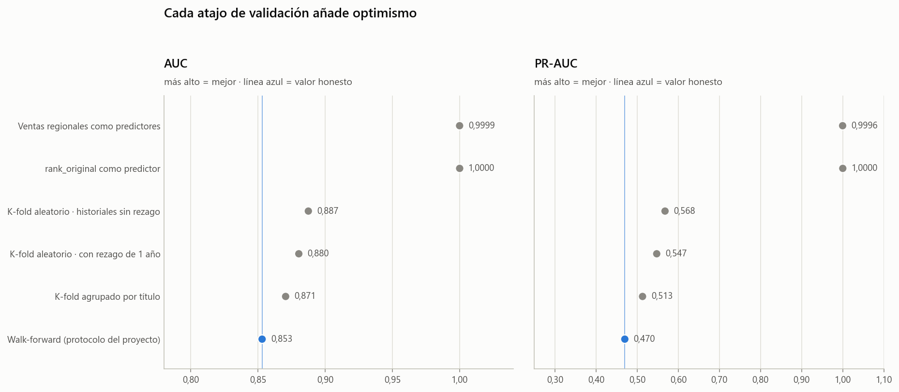
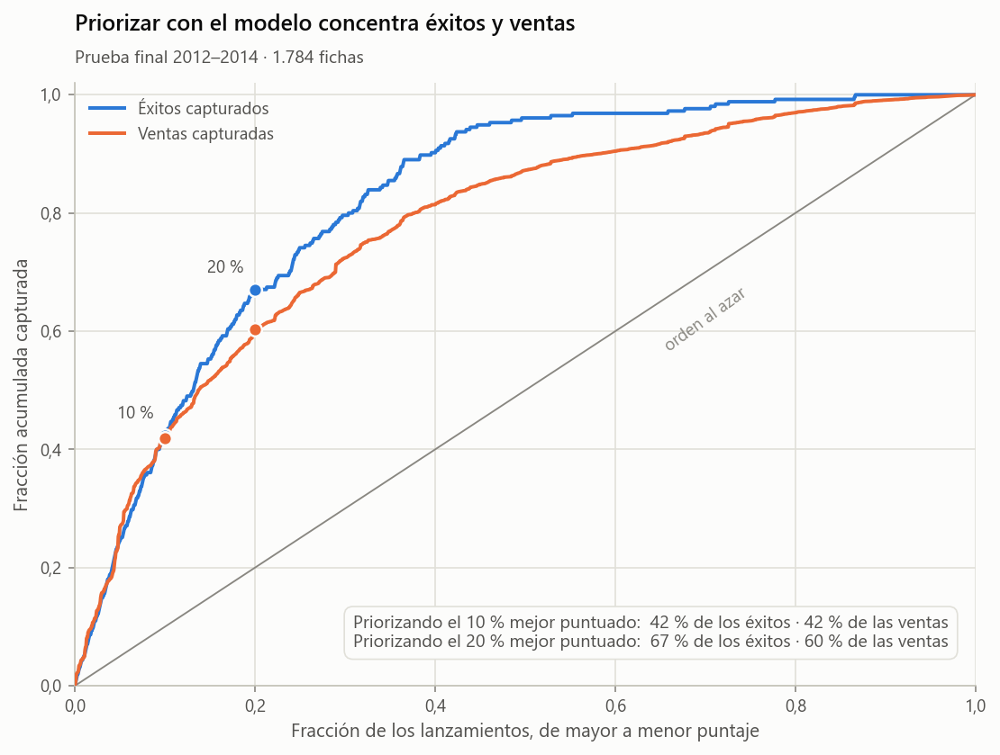

# ¿Qué hace que un videojuego venda más de un millón de copias?

**Análisis exploratorio y modelo predictivo sobre 16.598 fichas de ventas de videojuegos (1980–2016)**

> **Estado del proyecto:** completo — 3 notebooks ejecutados de principio a fin, 19 figuras y módulos reutilizables en `src/`.

---

## La pregunta

Cada año salen cientos de videojuegos y solo unos pocos superan el millón de copias. El proyecto responde a dos preguntas:

1. **Análisis:** ¿qué separa a los lanzamientos exitosos del resto?
2. **Modelo:** ¿se puede anticipar un éxito con lo que se sabe *antes* del lanzamiento, y con qué fiabilidad *real*?

El caso de uso imaginado es el de un equipo de catálogo o marketing que debe repartir presupuesto entre muchos lanzamientos y necesita **priorizar**, no adivinar la cifra exacta de ventas.

## Resultados en 30 segundos

| | |
|---|---|
| **Datos** | 16.598 fichas (juego × plataforma) → 14.734 analizables en la ventana 1995–2014 |
| **Éxito** | ≥ 1 M de copias en el mundo: el 12,2 % de las fichas |
| **Hallazgo principal** | **Importa quién publica, no qué género es.** El publisher separa las ventas cuatro veces más que el género (ε² 0,25 frente a 0,06). Nintendo logra un 46 % de éxitos frente al 11 % del resto |
| **Modelo** | *Gradient boosting* con 9 variables conocidas antes del lanzamiento |
| **Resultado en la prueba final (2012–2014)** | **AUC 0,877** (IC 95 % 0,851–0,902) · PR-AUC 0,548 (el azar da 0,143) |
| **Valor práctico** | El 10 % de los lanzamientos mejor puntuados contiene un 61 % de éxitos (≈ 4,2× la tasa base) y capta el 42 % de todos los éxitos |
| **Frente a una regla simple** | +0,072 de AUC (IC 95 % 0,039–0,104) sobre «apostar por el publisher con mejor historial» |

### Lo que hace creíble el número
El mismo modelo da un AUC de **0,887** con un *split* aleatorio y de **0,853** con una validación honesta. El proyecto mide cuánto optimismo añade cada atajo (mirar al futuro, mezclar épocas, separar a las «fichas hermanas» de un mismo juego) en lugar de quedarse con la cifra más bonita:





## Las trampas del dataset (y qué se hizo con cada una)

| Trampa | Qué pasa si se ignora | Decisión |
|---|---|---|
| `Global_Sales` = suma de las ventas regionales | Un modelo «acierta» el 100 % sin aprender nada | No se usan las ventas como predictores |
| `Rank` es el objetivo ordenado | Mismo problema | Se conserva solo como referencia |
| `"Unknown"` en `Publisher` es un nulo disfrazado (203 filas, más 58 `N/A`) | «Unknown» sería la 17.ª editora más grande | Nulo + bandera; no se imputa |
| 8 años imposibles (2017, 2020, o anteriores a la consola) | Fechas absurdas en el análisis temporal | Se anulan y se marcan |
| Homónimos que parecen duplicados (*Need for Speed: Most Wanted* 2005 vs 2012) | `drop_duplicates` borraría juegos legítimos | Solo se eliminan los 2 duplicados reales |
| 151 fichas con la fuente anotada en el nombre, p. ej. `(JP weekly sales)` | Doble conteo y ventas subestimadas | Bandera y fuera de los análisis por título |
| El 47 % de las fichas tienen «hermanas» (el mismo juego en otra consola) | Un *split* aleatorio filtra información | Validación temporal + remuestreo por título |
| Cobertura que cae un 42 % tras 2011 y años finales sin madurar | Conclusiones de mercado falsas | Ventana 1995–2014 fijada **antes** de modelar |
| Los historiales de saga usan ventas finales (acumuladas hasta 2016) | Mirada al futuro | Rezago de madurez de 1 año |

## Estructura

```
videogame_sales_analysis/
├── data/
│   ├── raw/vgsales.csv                      # copia congelada del dataset original
│   └── processed/vgsales_clean.csv          # salida del notebook 01 (16.596 filas × 20 columnas)
├── notebooks/
│   ├── 01_limpieza_y_auditoria.ipynb        ✅
│   ├── 02_analisis_exploratorio.ipynb       ✅
│   └── 03_modelado_exito_comercial.ipynb    ✅
├── reports/figures/                          # 19 figuras (PNG)
├── src/
│   ├── limpieza.py                           # pasos de limpieza + 18 verificaciones automáticas
│   ├── features.py                           # variables del modelo e historiales sin mirar al futuro
│   ├── modelado.py                           # modelos, walk-forward, métricas, bootstrap por título
│   └── estilo.py                             # paleta validada y formato numérico en español
├── tests/
│   └── test_nucleo.py                        # 8 pruebas: empates en las métricas, historiales sin fuga, limpieza
├── FICHA_PROYECTO.md
├── requirements.txt
└── README.md
```

## Notebooks

### 01 · Auditoría y limpieza
Revisa el archivo antes de confiar en él y documenta cada decisión con números. La limpieza es **no destructiva**: salvo 2 duplicados no se borra ninguna fila, se marcan con banderas. Termina con 18 verificaciones automáticas (`limpieza.validar`) y comprueba que aplicar los pasos uno a uno da lo mismo que el pipeline completo.

### 02 · Análisis exploratorio
Seis preguntas de negocio, cada una con su gráfico, su prueba estadística cuando hace falta y una lectura de lo que el dato permite decir.

| Pregunta | Resultado |
|---|---|
| ¿Qué tan concentrado está el éxito? | El 10 % de las fichas vende el 58 % del total (Gini 0,71); la media (0,53 M) triplica la mediana (0,17 M) |
| ¿Qué vida tiene una consola? | La mayoría vende más a los 3–5 años de su lanzamiento |
| ¿Qué géneros rinden más? | *Platform* y *Shooter* (18 %) frente a *Adventure* (3 %); diferencias reales pero pequeñas (ε² = 0,06) |
| ¿Tiene cada región gustos distintos? | Japón se desmarca (RPG ×2,8; *Shooter* ×0,23) y su cuota cae 5,9 puntos entre 1995–2004 y 2005–2014 |
| ¿Importan publisher, saga y salir en varias plataformas? | Publisher: ε² = 0,25. Saga con historial: OR 1,87 → 1,61 ajustado. «Salir en 3+ plataformas»: OR 1,64 → **1,30** al ajustar por tamaño del publisher (parte era confusión) |

### 03 · Modelado
Clasificador del éxito comercial con **validación walk-forward** (entrena con el pasado, predice el año siguiente).

- **Escalera de optimismo:** de 1,000 (variables prohibidas) a 0,853 (protocolo honesto).
- **Ablación por bloques** con una regla fijada de antemano (un bloque se conserva si sube el AUC ≥ 0,005): publisher, plataforma, ciclo de vida e historial de saga entran; el historial del publisher no.
- **Baselines:** azar y «regla del analista». La regresión logística rinde igual que el *gradient boosting*: el límite está en la información, no en el algoritmo.
- **Prueba final 2012–2014** con intervalos por *bootstrap* de títulos, **prueba de estrés** en 2015–2016 (2016 rompe el modelo, 2015 no), calibración, importancia por grupos y análisis de errores.

## Cómo reproducirlo

```bash
pip install -r requirements.txt
python tests/test_nucleo.py   # opcional: 8 pruebas de las piezas críticas (empates, fugas, limpieza)
python src/limpieza.py        # opcional: regenera data/processed/vgsales_clean.csv
jupyter lab                   # ejecutar los notebooks en orden: 01 → 02 → 03
```

El notebook 03 tarda unos 2–3 minutos (validaciones repetidas y *bootstrap*). Todo es determinista (semilla 0).

Probado con Python 3.14, pandas 3.0, scikit-learn 1.8 y matplotlib 3.10.

## Datos

**Fuente:** dataset público *Video Game Sales* en Kaggle ([kaggle.com/datasets/gregorut/videogamesales](https://www.kaggle.com/datasets/gregorut/videogamesales)), que según su descripción se generó con un *scraper* de vgchartz.com. Las ventas están en **millones de copias** y son **estimaciones** de esa web. `data/raw/vgsales.csv` es una copia congelada (16.598 filas × 11 columnas) para que el proyecto sea reproducible; antes de redistribuir el repositorio conviene revisar la licencia de la fuente.

Columnas del dataset limpio (`data/processed/vgsales_clean.csv`):

| Columna | Descripción |
|---|---|
| `nombre`, `plataforma`, `anio`, `genero`, `publisher` | La ficha: juego, consola, año, género y editora |
| `ventas_na`, `ventas_eu`, `ventas_jp`, `ventas_otros`, `ventas_global` | Ventas por región y mundiales (M de copias) |
| `rank_original` | Posición por ventas en el archivo original (**no usar como predictor**) |
| `fabricante`, `tipo_plataforma`, `edad_plataforma` | Derivadas de la plataforma |
| `franquicia` | Clave heurística de la saga, a partir del nombre |
| `exito` | 1 si `ventas_global` ≥ 1 M |
| `en_ventana` | Año entre 1995 y 2014 |
| `publisher_desconocido`, `anio_invalido`, `registro_parcial` | Banderas de calidad |

## Limitaciones

- **Cifras estimadas** y de cobertura cambiante; no se sabe si incluyen ventas digitales.
- **Asociación, no causalidad**: el modelo no dice que cambiar de publisher *cause* el éxito.
- **Faltan variables** decisivas: presupuesto, marketing, reseñas, fecha exacta de lanzamiento.
- **La heurística de franquicia** falla en sagas que cambian de nombre por edición (*Pokémon*) y las variantes regionales de un publisher no se unifican.
- **Probabilidades subestimadas** tras 2011: el modelo sirve para ordenar, no para estimar cuántos éxitos habrá.
- **La prueba final no es completamente «virgen»**: durante el desarrollo se probaron variantes de diseño y se consultaron resultados de 2012–2014 (las diferencias fueron menores de 0,01 de AUC). Está explicado en el notebook 03.

## Stack

Python · pandas · NumPy · SciPy · scikit-learn · matplotlib · Jupyter.
